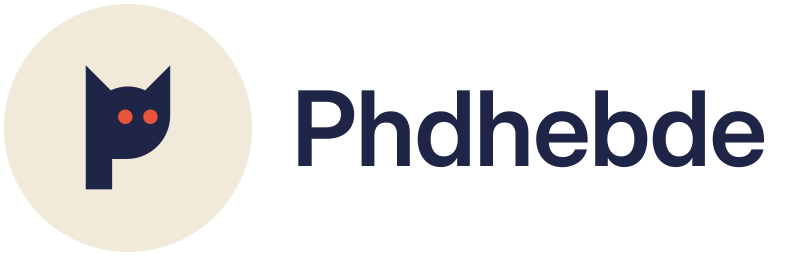

  <picture>
    <source media="(prefers-color-scheme: dark)" srcset="assets/phdhebde-horizontal-dark.svg">
    
  </picture>

### Hi, I'm Maxence 👋

Security & infrastructure engineer at a French cybersecurity firm, based in Lyon.
I build tools that make security work cleaner to deliver: privileged-access bastions, self-hosted infrastructure, and the reports at the end of an engagement.

- 🔐 **Day job:** PAM bastion, security audits, incident response, SOC/SIEM
- 🧱 **Infra:** Kubernetes (K3s, Rancher, Longhorn), self-hosted GitLab, GitOps, monitoring
- 🛠️ **Building:** Obsidian plugins for professional reporting
- 🇫🇷 / 🇬🇧 French and English

---

#### ⭐ Featured

<table>
  <tr>
    <td width="50%" valign="top">
      <a href="https://github.com/Phdhebde/Obisidian-pdf-export"><b>Report Exporter</b></a> 
      TypeScript · Obsidian plugin · MIT  
      Export Obsidian notes as professional <b>PDF and Word reports</b>: branded templates, cover page, table of contents, Mermaid, callouts, footnotes — and client versions with internal passages removed before rendering. Fully offline.  
      <a href="https://phdhebde.github.io/Obisidian-pdf-export/">Documentation</a> ·
      <a href="https://github.com/Phdhebde/Obisidian-pdf-export/releases/latest">Latest release</a>
    </td>
    <td width="50%" valign="top">
      <a href="https://github.com/Phdhebde/guacamole-lite"><b>guacamole-lite</b></a> 
      JavaScript · Node.js  
      Lightweight Node.js server to reach remote desktops over <b>RDP/VNC from an HTML5 browser</b>, through Apache guacd (up to 1.6.0).
    </td>
  </tr>
</table>

---

#### 🧰 Stack

Open to feedback, issues and pull requests on any of my projects.
